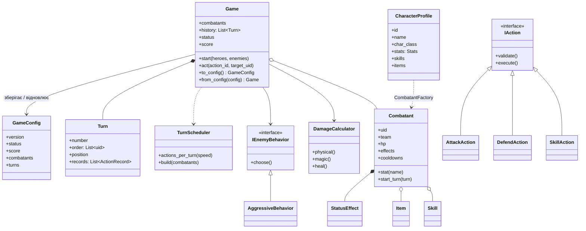
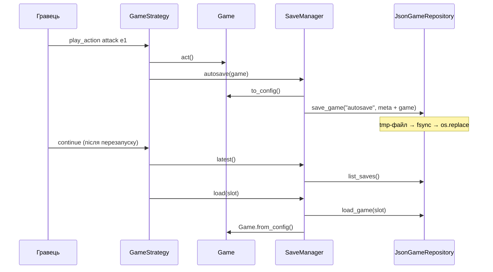

# Дизайн-документ проєкту «Текстова гра»

**Практичні заняття 14–15. Бізнес-логіка та постійність інформації**
Виконала: Фізик Анна, група КН-33, 3 курс

---

## 1. Архітектура системи

Проєкт побудований на тришаровій архітектурі:

| Шар | Папка | Відповідальність |
|---|---|---|
| Представлення | `CLI/` | Парсинг команд, виведення результатів, патерни Фасад, Стратегія, Команда |
| **Бізнес-логіка** | `Core/` | Правила гри, формули шкоди, покрокова система, моделі персонажів |
| Інфраструктура | `Infra/` | Збереження у системній папці даних (JSON-файли), отримання даних з API, консольна графіка |

Головне правило: **`Core` не імпортує нічого з `CLI` та `Infra`**. Ядро лише оголошує інтерфейси (`Core/interfaces.py`), а інші шари їх реалізують:

| Інтерфейс у Core | Реалізація | Шар |
|---|---|---|
| `IRenderer`, `IRenderable` | `ProfileConsoleRenderer`, `GameConsoleRenderer`, `CombatantConsoleRenderer` | Infra |
| `ICharacterSource` | `GenshinApiSource`, `StubCharacterSource`, `FallbackCharacterSource` | Infra |
| `IProfileRepository`, `IGameRepository` | `JsonProfileRepository`, `JsonGameRepository` (через `JsonFileStore`) | Infra |

У практичній 13 інтерфейси `IRenderable`/`IRenderer` лежали в `CLI/presenter.py`, і `Core` імпортував їх із шару представлення. Тепер вони перенесені в `Core/interfaces.py`, а `CLI` лише використовує їх. Так залежності йдуть тільки в бік ядра (принцип інверсії залежностей).

## 2. Структура бізнес-шару

| Файл | Класи | Призначення |
|---|---|---|
| `stats.py` | `Stats`, `Modifier`, `StatusEffect`, `Item` | Характеристики, модифікатори, баффи/дебаффи, предмети |
| `skills.py` | `Skill`, `SkillLibrary` | Навички та набори навичок для кожного класу |
| `characters.py` | `CharacterProfile`, `CharacterManager`, `ApiProfileMapper`, `CharacterService` | Каталог персонажів, перетворення відповіді API у профіль |
| `combatant.py` | `Combatant`, `CombatantFactory`, `EnemyLibrary` | Модель учасника бою, створення героїв і ворогів |
| `combat.py` | `DamageCalculator`, `DamageReport` | Формули шкоди та лікування |
| `actions.py` | `IAction`, `AttackAction`, `DefendAction`, `SkillAction`, `ActionResolver`, `ActionRecord` | Дії учасників (патерн Команда) |
| `ai.py` | `IEnemyBehavior`, `AggressiveBehavior` | Поведінка ворогів (патерн Стратегія) |
| `game.py` | `Game`, `GameConfig`, `Turn`, `TurnScheduler`, `GameStatus` | Основний цикл гри, кроки, знімок стану |
| `saves.py` | `SaveManager`, `SaveInfo`, `ProfileStorage`, `migrate_legacy` | Правила збереження: слоти, автозбереження, «останній сейв», персонажі користувача |

### 2.1. Діаграма класів



### 2.2. Шлях даних

```
API / characters.json  →  CharacterProfile  →  CombatantFactory  →  Combatant  →  Game
                                                                                ↓
                    saves/<слот>.json  ←  SaveManager  ←  GameConfig  ←  to_config()
```

`CharacterProfile` — це «паспорт» персонажа, який зберігається в каталозі (власний персонаж або завантажений з API). Під час старту бою з нього створюється `Combatant` — окремий об'єкт із поточним HP, ефектами та перезарядками. Тому бій не змінює дані в каталозі.

## 3. Характеристики персонажа

| Характеристика | Поле | Опис |
|---|---|---|
| Health | `health` | Максимальне здоров'я |
| Damage | `damage` | Базова фізична шкода (`dmg_flat` для фізичної атаки) |
| Magic | `magic` | Базова магічна шкода (`dmg_flat` для магії) |
| Armor (flat defense) | `armor` | Скільки фізичної шкоди блокується напряму |
| Resist | `resist` | Частка шкоди, що ігнорується (0.2 = 20%) |
| Resistance penetration | `res_pen` | Частка резисту цілі, яку атака ігнорує |
| Speed | `speed` | Скільки дій і в якому порядку персонаж робить за крок |

### 3.1. Модифікатори

Кожен предмет і кожен ефект містить список `Modifier(stat, value)`.

* Якщо `stat` — одна з характеристик вище, значення **додається** до неї.
* `power` — відсоткове підсилення всієї шкоди (`0.3` = +30%).
* `weaken` — відсоткове ослаблення шкоди від дебаффу (`0.3` = −30%).

Ефективне значення характеристики:

```
stat_eff = stat_base + Σ modifier(stat)  (з предметів і активних ефектів)
```

## 4. Формули

### 4.1. Допоміжні величини

```
bonus_flat  = Σ (bonus_item + bonus_skill + bonus_buff)     — пласкі бонуси до шкоди
bonus_prof  = 1 + Σ power                                    — множник підсилень
dmg_ability = Σ weaken                                        — ослаблення від дебаффів
res_mult    = max(0, 1 − res_tgt + res_pen)                  — множник резисту
pow_mult    = max(0, bonus_prof − dmg_ability)               — підсумковий множник
```

`res_pen` складається з характеристики атакуючого та бонусу навички (наприклад, «Пробивний постріл» дає +0.4).

### 4.2. Фізична атака

```
after_armor = dmg_flat + bonus_flat − armor_tgt
якщо after_armor ≤ 0  →  шкода = 0 (броня повністю перекрила удар)
інакше  dmg_phys = round( after_armor × res_mult × pow_mult )
```

Спочатку від чистої шкоди віднімається броня. Якщо результат менший або дорівнює нулю, атака нічого не пробила. Якщо атака пройшла крізь броню, застосовується модифікатор резисту, зважений відносно одиниці (100%), а потім множник бонусів.

### 4.3. Магічна атака

Магія **ігнорує броню**, але на неї краще працюють резисти:

```
dmg_magic = round( (dmg_flat × max(0, 1 − res_tgt + res_pen) + bonus_flat) × max(0, bonus_prof − dmg_ability) )
```

### 4.4. Лікування

```
heal = round( (skill_power + magic × 0.5) × bonus_prof )
```

Лікування не може підняти HP вище максимуму.

### 4.5. Приклади розрахунків

| Ситуація | Розрахунок | Результат |
|---|---|---|
| Артур (шкода 24, меч +6) атакує Гобліна (броня 4, резист 10%) | (24 + 6 − 4) × 0.9 × 1.0 = 23.4 | **23** |
| Те саме, навичка «Потужний удар» (+15) | (24 + 6 + 15 − 4) × 0.9 = 36.9 | **37** |
| «Потужний удар» під «Бойовим кличем» (+30%) | 41 × 0.9 × 1.3 = 47.97 | **48** |
| Мерлін (магія 22, посох +5 магії і +10%, res_pen 0.1) — «Вогняна куля» (+20) по Слизовому магу (резист 30%) | (22 × 0.8 + 25) × 1.1 = 46.86 | **47** |
| Мерлін (шкода 10) б'є Орка (броня 10) звичайною атакою | 10 − 10 = 0 | **0, блок** |

Ці значення перевіряються автоматичними тестами в `Tests/test_core.py`.

## 5. Покрокова система

### 5.1. Крок (Turn)

Бій складається з послідовності кроків. Кожен крок — окремий об'єкт `Turn`, який зберігає:

* номер кроку;
* порядок дій (`order`) — список ідентифікаторів учасників;
* позицію поточного учасника;
* журнал дій (`records`).

Інкапсуляція кроку в окремий клас потрібна, щоб легко переглядати історію бою (`play_history`) та щоб спростити підрахунок порядку дій і їх кількості.

### 5.2. Швидкість і порядок дій

`TurnScheduler` будує порядок на початку кожного кроку:

```
кількість дій = max(1, speed // 100)
час i-ї дії   = i / кількість дій      (i = 0, 1, ...)
сортування    за часом, потім за швидкістю (більша — раніше)
```

| Швидкість | Дій за крок | Коли ходить |
|---|---|---|
| 100 | 1 | на початку кроку, після швидших |
| 150 | 1 | перед персонажем зі швидкістю 100 |
| 200 | 2 | першим, і ще раз посередині кроку |
| 300 | 3 | на початку, на 1/3 та на 2/3 кроку |

Приклад зі швидкостями 200, 150, 100: `200 → 150 → 100 → 200`.

Швидкість можуть змінювати ефекти (наприклад, «Липкість» дає −40), тому порядок перераховується для кожного нового кроку.

### 5.3. Початок дії учасника

Коли учасник уперше ходить у новому кроці:

1. Перезарядки всіх його навичок зменшуються на 1.
2. Спрацьовують ефекти з `hp_per_turn` (отрута, опік — шкода; благословення — лікування).
3. Тривалість кожного ефекту зменшується на 1; ефекти з тривалістю 0 знімаються.

Ефект, накладений у поточному кроці, не зменшується в цьому ж кроці. Тому «тривалість 2» означає два наступні кроки цілі.

### 5.4. Дії гравця

| Дія | Ціль | Опис |
|---|---|---|
| `attack` | ворог | Звичайна фізична атака |
| `defend` | себе | +10 броні та +20% резисту до свого наступного кроку |
| `<skill_id>` | залежить від навички | Використання навички класу |

Якщо ціль не вказана: для атаки береться перший живий ворог, для лікування і баффів союзнику — союзник із найменшою часткою HP, для баффів на себе — сам персонаж.

### 5.5. Навички класів

| Клас | Навички |
|---|---|
| Воїн | Потужний удар (фізична +15, перезарядка 2), Бойовий клич (+30% шкоди на 2 кроки, перезарядка 4) |
| Маг | Вогняна куля (магічна +20 і опік 5 HP/крок, перезарядка 3), Прокляття (−30% шкоди і −15% резисту цілі, перезарядка 4) |
| Цілитель | Лікування (30 + 0.5 × магія, перезарядка 2), Благословення (+8 броні і +5 HP/крок на 3 кроки, перезарядка 4) |
| Лучник | Пробивний постріл (+8, ігнорує 40% резисту), Отруйна стріла (+5 і отрута 6 HP/крок на 3 кроки) |

### 5.6. Вороги

| ID | Назва | HP | Шкода | Магія | Броня | Резист | Швидкість | Навички |
|---|---|---|---|---|---|---|---|---|
| goblin | Гоблін | 90 | 18 | 0 | 4 | 10% | 120 | Розмашистий удар |
| slime | Слизовий маг | 70 | 8 | 20 | 2 | 30% | 90 | Слизовий заряд |
| wolf | Лютий вовк | 70 | 14 | 0 | 1 | 0% | 200 | — |
| orc | Орк-вождь | 160 | 24 | 0 | 10 | 5% | 80 | Розмашистий удар, Бойовий клич |

Поведінка ворогів (`AggressiveBehavior`): ворог обирає героя з найменшим HP. Він використовує першу готову навичку: бафф на себе, якщо його ще немає, або атакувальну навичку. Якщо всі навички на перезарядці — звичайна атака.

### 5.7. Завершення гри і рахунок

* **Перемога** — усі вороги переможені; **поразка** — усі герої переможені.
* Очки = шкода героїв по ворогах × 10.
* Бонус за перемогу = max(0, 500 − 20 × номер кроку).

## 6. Постійність інформації (збереження і завантаження)

### 6.1. Що зберігається

| Дані | Файл | Коли записується |
|---|---|---|
| Персонажі, створені користувачем (`create`) або імпортовані з API (`import`) | `characters.json` | Одразу після створення, імпорту чи видалення |
| Стан гри | `saves/autosave.json` | Автоматично після старту бою, після кожної дії гравця і при виході з програми |
| Стан гри в іменованому слоті | `saves/<слот>.json` | Командою `game_save <слот>` |

Вбудованих персонажів (Артур, Мерлін, Ліра) у файл не записуємо: вони є частиною коду й завжди створюються під час запуску. Так файл містить лише дані користувача, і зміна балансу вбудованих героїв не конфліктує зі старими файлами.

### 6.2. Де зберігається

Дані не записуються в папку з програмою, а лежать у стандартній системній папці для даних додатків (`AppDataLocator`):

| ОС | Папка |
|---|---|
| Windows | `%APPDATA%\OOPTextGame` (тобто `C:\Users\<ім'я>\AppData\Roaming\OOPTextGame`) |
| Linux | `$XDG_DATA_HOME/oop-text-game`, типово `~/.local/share/oop-text-game` |
| macOS | `~/Library/Application Support/OOPTextGame` |

На Linux обрано `~/.local/share`, а не `/usr/share` чи `/usr/local`: ті папки спільні для всієї системи, і писати туди звичайному користувачу без прав адміністратора не можна. Папку можна перевизначити змінною `OOP_GAME_HOME` або параметром `--data-dir=...`; це зручно для тестів і для перенесення збережень. Команда `storage` показує, де саме лежать дані.

### 6.3. Формат файлів

Обрано **JSON**: він компактний, підтримується стандартною бібліотекою Python (`json`), його легко прочитати очима, і стан гри вже вміє перетворюватись у словник (`to_dict` / `from_dict`). XML дає багато службового тексту, а YAML потребує сторонньої бібліотеки й чутливий до відступів, тому для збережень вони гірші.

Кожен файл загорнутий у «конверт» з описом:

```json
{
  "format": "oop-text-game",
  "version": 3,
  "kind": "save",
  "written_at": "2026-11-24T14:36:38",
  "data": {
    "meta": { "slot": "autosave", "saved_at": "...", "turn": 2, "status": "active", "score": 370, "heroes": ["Артур", "Лицар"] },
    "game": { "version": 2, "status": "active", "score": 370, "combatants": [ ... ], "turns": [ ... ] }
  }
}
```

* `format` і `kind` не дають випадково прочитати чужий файл або файл персонажів як збереження.
* `version` дозволяє в майбутньому змінювати формат і розпізнавати старі файли.
* `meta` — короткий опис збереження. Команда `saves` показує список, не відновлюючи кожну гру повністю.
* `game` — повний знімок `GameConfig` з практичної 14: учасники з HP, ефектами, перезарядками, усі кроки з історією та позиція поточного ходу.

### 6.4. Надійність

* **Атомарний запис.** Спочатку дані пишуться у тимчасовий файл `*.tmp`, потім `os.fsync` скидає їх на диск, і `os.replace` одним кроком замінює старий файл. Якщо програма впаде посеред запису, попереднє збереження залишиться цілим.
* **Пошкоджені файли.** Якщо файл не читається (зламаний JSON, чужий формат, новіша версія), він перейменовується на `*.corrupt`, а користувач бачить попередження. Програма не падає, а пошкоджений файл можна відкрити вручну.
* **Безпечні назви слотів.** Назва слоту — лише латинські літери, цифри, `_` і `-`, до 32 символів. Тому `game_save ../hack` не зможе записати файл поза папкою `saves`.
* **Помилки диска.** Помилки запису (`OSError`) перехоплюються в CLI, і користувач отримує повідомлення замість аварійного завершення.

### 6.5. «Останній сейв» і продовження гри

`SaveManager.latest()` повертає збереження з найпізнішим часом `saved_at` серед усіх слотів, і автоматичного, і ручних. Під час запуску програма показує, яке збереження знайдено, а команда `continue` (або `game_load` без параметрів) відновлює саме його. Оскільки автозбереження робиться після кожної дії, гра продовжується рівно з того ходу, на якому користувач вийшов, навіть якщо він закрив програму без `game_save`.



### 6.6. Розподіл відповідальності

* **Core** (`SaveManager`, `ProfileStorage`) вирішує, *що* і *коли* зберігати: назви слотів, автозбереження, вибір останнього сейву, які персонажі належать користувачу. Ядро працює через інтерфейси `IGameRepository` / `IProfileRepository` і не знає про файли.
* **Infra** (`JsonFileStore`, `JsonGameRepository`, `JsonProfileRepository`, `AppDataLocator`) вирішує, *де* і *як* записати: шлях до папки, формат JSON, атомарність, обробку пошкоджених файлів. Щоб перейти, наприклад, на SQLite, достатньо написати нову реалізацію репозиторіїв; бізнес-логіку змінювати не потрібно.

### 6.7. Перехід зі старої версії

У практичних 13–14 усе лежало в одному файлі `repository.json` поруч із програмою. Якщо такий файл знайдено під час запуску:

1. Персонажі з нього переносяться до `characters.json`; ті, що збігаються з вбудованими за ID, пропускаються.
2. Збереження гри формату практичної 14 (`version: 2`) переноситься у слот `imported`. Стан практичної 13 мав інший формат без версії, тож переноситься лише список персонажів, і користувач бачить про це повідомлення.
3. Файл перейменовується на `repository.json.migrated`, щоб перенесення не повторювалось.

## 7. Завантаження нових персонажів

1. `CharacterService.import_character(name)` отримує сирий JSON через `ICharacterSource`.
2. `ApiProfileMapper.from_api()` перетворює його у `CharacterProfile`:

| Поле API | Що визначає |
|---|---|
| `rarity` | HP = 80 + 10·r, шкода = 8 + 3·r, броня = 2·r, резист = min(25%, 4%·r) |
| `vision` | Клас: Pyro/Electro → Маг, Hydro/Dendro → Цілитель, Geo → Воїн, Anemo/Cryo → Лучник |
| `weapon` | Швидкість: Bow 120, Sword 110, Polearm 105, Catalyst 100, Claymore 85; дворучна зброя дає +4 броні |

3. Профіль додається в каталог і може брати участь у бою.

Джерело даних — `FallbackCharacterSource`: спочатку запит до `https://genshin.jmp.blue`, а якщо сервер недоступний — **заглушка** `StubCharacterSource` з тестовими даними (diluc, venti, zhongli, barbara, fischl). Так компонент працює і без мережі.

Також можна створити власного персонажа командою `create`. Створені та імпортовані персонажі зберігаються автоматично (див. розділ 6). Старий формат персонажів (`hp`, `attack`) з практичної 13 автоматично перетворюється у нові характеристики.

## 8. Використані патерни

| Патерн | Де |
|---|---|
| Фабрика | `CombatantFactory` — створення учасників бою з профілю або шаблону ворога |
| Команда | `IAction` і нащадки — кожна дія є окремим об'єктом із `validate` / `execute` |
| Стратегія | `IEnemyBehavior` — поведінку ворогів можна замінити, не змінюючи `Game` |
| Знімок (Memento) | `GameConfig` — збереження й відновлення стану гри |
| Репозиторій | `IGameRepository`, `IProfileRepository` — ядро не знає, де і як лежать файли |
| Сервісний шар | `SaveManager`, `ProfileStorage` — правила збереження окремо від файлової системи |
| Адаптер / Маппер | `ApiProfileMapper` — перетворення відповіді API у доменну модель |
| Замісник (заглушка) | `StubCharacterSource`, `FallbackCharacterSource` |
| Інверсія залежностей | Інтерфейси в `Core/interfaces.py`, реалізації в `Infra` |
| Фасад, Стратегія, Команда (CLI) | `CLI`, `CatalogStrategy`, `GameStrategy`, `SystemStrategy` |

## 9. Команди

| Команда | Опис |
|---|---|
| `list`, `show <id>` | Каталог персонажів |
| `create` | Створити власного персонажа (одразу зберігається) |
| `delete <id>` | Видалити власного персонажа |
| `import <name>`, `sources` | Завантажити персонажа з API |
| `save` | Примусово зберегти каталог |
| `play_start <id> [<id>...] [--enemies=goblin,wolf]` | Почати бій (кілька героїв, вибір ворогів) |
| `play_action <дія> [ціль]` | Дія поточного героя, напр. `play_action fireball e2` |
| `play_status` | Стан бою, порядок ходів, доступні дії |
| `play_history [--last=N]` | Історія кроків |
| `continue` | Продовжити з останнього збереження |
| `game_save [слот]`, `game_load [слот]` | Збереження в слот і завантаження зі слоту |
| `saves`, `save_delete <слот>` | Список збережень, видалення збереження |
| `storage` | Показати папку з даними |
| `enemies`, `skills` | Довідники ворогів і навичок |

Приклад сесії:

```
> import diluc
> play_start warrior_1 mage_1 --enemies=goblin,wolf
> play_action fireball e2
> play_action war_cry
> play_action strike e1
> play_history
> game_save before_boss
> exit

(новий запуск)
> continue
```

## 10. Тестування

Запуск: `python -m pytest`

* `Tests/test_core.py` — формули шкоди (броня, резист, пробиття, бонуси, дебаффи, магія), порядок ходів за швидкістю, ефекти, перезарядки, повний бій до перемоги, недопустимі дії, збереження й відновлення, маппер API, старий формат даних.
* `Tests/test_storage.py` — вибір системної папки для Windows/Linux/macOS, формат файлу, атомарний запис, обробка пошкодженого файлу, збереження і відновлення гри, «останній сейв», помилки слотів, запис лише власних персонажів, міграція старого `repository.json`.
* `Tests/test_cli.py` — парсер аргументів, продовження гри після «перезапуску» (`continue`), ручні слоти, захист від небезпечних назв слотів, створення і видалення персонажа зі збереженням між запусками.

Усього 29 тестів, усі проходять. Тести працюють у тимчасовій папці (`tmp_path`), тому не чіпають справжні збереження.

## 11. Запуск

```
python main.py                 — інтерактивний режим
python main.py continue        — одразу продовжити останню гру
python main.py --data-dir=./data   — тримати дані в іншій папці
```

Папку даних також можна змінити змінною середовища `OOP_GAME_HOME`.

Потрібен Python 3.10+, сторонні бібліотеки не використовуються (крім `pytest` для тестів).
